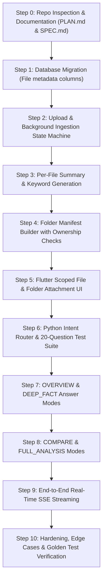

# Master Plan: Folder & File RAG System with Realtime Streaming

---

## 1. Executive Summary & Objective

This plan details the implementation of an end-to-end Folder & File Retrieval-Augmented Generation (RAG) system with real-time Server-Sent Events (SSE) streaming for `spaces_app`.

### Core Capabilities:
1. **In-App File & Folder Attachment**: The user can attach an entire Space/Folder or pick specific files from within the active Space via the chat paperclip (`📎`).
2. **Hierarchical Multi-Document RAG**:
   - Understands macro folder questions (*"tell me about the files in this folder"*).
   - Executes pinpoint vector search for micro questions (*"what is the refund fee?"*).
   - Compares documents (*"compare file A with file B"*).
   - Performs complete folder synthesis (*"analyse the entire folder"*).
3. **Resilient Background Ingestion**:
   - Status transitions: `uploaded` ➔ `extracting` ➔ `chunking` ➔ `embedding` ➔ `summarizing` ➔ `ready` (or `failed`).
   - Generates <= 150-word summary, <= 8 keywords, and page count per file.
4. **Real-time SSE Streaming**:
   - Status lines ➔ text token streaming ➔ structured citation pills ➔ done event.
   - Includes 15-second heartbeat and cancellation support.

---

## 2. Phased Build Order (Step-by-Step)

---

### Step 0: Documentation & Architecture Alignment (Current Step)
* **Goal**: Inspect the existing codebase and document the exact contracts, schemas, event formats, and rules.
* **Deliverables**:
  - `docs/PLAN.md` (this file)
  - `docs/SPEC.md`
* **Exit Criteria**: Stop and obtain user approval.

---

### Step 1: Database Migrations
* **Goal**: Add hierarchical RAG columns to `File` table without data loss on SQLite and PostgreSQL.
* **Files to Modify**:
  - `backend/prisma/schema.prisma`: Add `summary`, `keywords`, `pageCount`, `extractedText`.
* **Execution**:
  - Run `npx prisma db push` or migration.
  - Run `npx prisma generate`.
* **Verification**: Verify existing tables and records remain intact with null/default values.

---

### Step 2: Upload & Background Ingestion Pipeline
* **Goal**: Update ingestion pipeline to track progress through explicit states: `extracting`, `chunking`, `embedding`, `summarizing`, `ready`, or `failed`.
* **Files to Modify**:
  - `backend/src/workers/job.worker.ts`: Forward ingestion jobs and track intermediate progress.
  - `ai_service/services/document_ingestion_service.py`: Log each stage timing.
  - `ai_service/main.py`: Stream callback status events.
* **Verification**: Ingestion updates `file_index_status` and emits realtime progress events to the client.

---

### Step 3: Per-File Summary & Keyword Generation
* **Goal**: Automatically generate an executive summary (<= 150 words) and up to 8 keywords during ingestion.
* **Files to Modify**:
  - `ai_service/services/document_ingestion_service.py`: Invoke lightweight summary extraction on full extracted text.
  - `ai_service/schemas.py`: Add `summary`, `keywords`, `pageCount`, and `extractedText` to `IndexCallback`.
  - `backend/src/modules/ai/ai.schema.ts`: Validate callback payload.
  - `backend/src/modules/ai/ai.service.ts`: Store summary and keywords in `prisma.file`.
* **Verification**: Ingestion of a sample document stores a readable summary and keyword array.

---

### Step 4: Folder Manifest Builder with Ownership Checks
* **Goal**: Backend builds a structured manifest of files in the active Space with strict user ownership validation.
* **Files to Modify**:
  - `backend/src/modules/ai/ai.service.ts`:
    - `buildFolderManifest(userId, spaceId, targetFileIds)`: Validates ownership; retrieves names, sizes, statuses, summaries, and keywords.
    - Security: Discard any `spaceId` or `fileId` not owned/permitted by `userId`.
* **Verification**: Unit tests proving unauthorized IDs are rejected with `403` or excluded.

---

### Step 5: Flutter Scoped File & Folder Attachment UI
* **Goal**: Provide intuitive in-app file and Space attachment via the chat paperclip (`📎`).
* **Files to Modify**:
  - `spaces_app/lib/presentation/screens/ai/ai_chat_screen.dart`:
    - Tapping `📎` presents bottom modal: *"Attach Entire Folder"* or *"Pick Files from <Space>"*.
    - Renders active context chips above the input bar:
      - `[ 📁 Folder: Rohith (14 files) ✕ ]`
      - `[ 📄 handbook.docx ✕ ]`
  - `spaces_app/lib/providers/ai_chat_provider.dart`:
    - Adds `attachedSpaceId`, `attachedFileIds` to state.
    - Sends `spaceIds` and `fileIds` in request payload.
* **Verification**: Flutter UI test verifying chip removal, selection modal filtering, and payload construction.

---

### Step 6: Python Intent Router & 20-Question Test Suite
* **Goal**: Route queries into `OVERVIEW`, `DEEP_FACT`, `COMPARE`, or `FULL_ANALYSIS`.
* **Files to Modify**:
  - `ai_service/services/intent_router.py`: Keyword heuristics + Gemini fallback classifier.
  - `ai_service/tests/test_intent_router.py`: 20 evaluation questions.
* **Verification**: Automated test asserting at least 18 of 20 questions route to expected mode.

---

### Step 7: OVERVIEW and DEEP_FACT Modes (Non-Streaming Baseline)
* **Goal**: Implement deterministic answer synthesis for directory overviews and fact lookups.
* **Files to Modify**:
  - `ai_service/services/rag_service.py`:
    - `OVERVIEW`: Answers strictly using `folder_manifest` and file summaries.
    - `DEEP_FACT`: Uses cosine distance on chunks scoped to selected files with `[File > Page]` citations.
* **Verification**: Tested against Golden Test Folder fixture files.

---

### Step 8: COMPARE and FULL_ANALYSIS Modes
* **Goal**: Enable multi-file cross-comparison and whole-folder deep analysis.
* **Files to Modify**:
  - `ai_service/services/rag_service.py`:
    - `COMPARE`: Merges chunk sets from multiple named files.
    - `FULL_ANALYSIS`: Synthesizes across all file summaries and parallel reads.
* **Verification**: Accurate multi-document answers comparing policies and technical documents.

---

### Step 9: End-to-End Real-Time SSE Streaming
* **Goal**: Wire real-time SSE streaming across Flutter, Node.js backend, and Python AI service.
* **Files to Modify**:
  - `ai_service/main.py`: Generates `status`, `text`, `citations`, `done`, and `heartbeat` events.
  - `backend/src/modules/ai/ai.controller.ts`: Pipes SSE without buffering.
  - `spaces_app/lib/providers/ai_chat_provider.dart`: Parses status messages and displays citation pills.
* **Verification**: Manual test verifying word-by-word streaming, status display, and cancellation.

---

### Step 10: Hardening, Edge Cases & Verification
* **Goal**: Ensure production reliability across all failure modes.
* **Test Cases**:
  - Empty Space (0 files) ➔ Displays clean empty message.
  - Corrupted / unextractable files ➔ Correctly reports error and continues with remaining files.
  - Partially ready Space (e.g., 2 ready, 1 indexing) ➔ Discloses status and answers from ready files.
  - User cancellation mid-stream ➔ Aborts client connection cleanly.
* **Verification**: Full test suite pass + Golden Folder verification.

---

## 3. Strict Operating Rules

1. **One Step at a Time**: Never proceed to the next step without explicit user approval.
2. **Zero Guesswork**: Always test before claiming completion.
3. **Security First**: Every DB query filters by `userId`. Never trust client-supplied IDs.
4. **No Unapproved Packages**: Use existing packages (`@prisma/client`, `fastapi`, `google-genai`, `http`).
